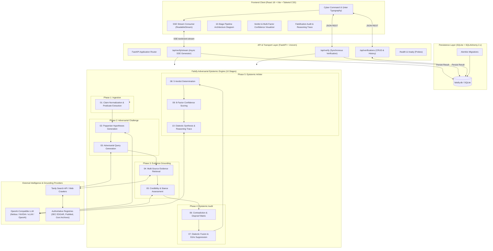

# Falsify: Autonomous Claim-Level Adversarial Verification

[](https://www.python.org/downloads/)
[](https://fastapi.tiangolo.com/)
[](https://react.dev/)
[](https://www.typescriptlang.org/)
[](https://tailwindcss.com/)
[](https://vitest.dev/)
[](https://docs.pytest.org/)
[](https://opensource.org/licenses/MIT)

**Falsify** is an autonomous, claim-level adversarial verification platform rooted in **Karl Popper's doctrine of falsificationism**: a scientific statement, empirical assertion, or corporate claim cannot be verified purely through confirmation bias or sycophantic LLM consensus.

Instead of hunting for confirmation, Falsify formulates rigorous Popperian counter-hypotheses, constructs adversarial queries, crawls authoritative multi-source registries, detects direct empirical contradictions, clusters independent evidence while suppressing duplicate echo chambers, and produces a definitive 5-state verdict accompanied by an 8-factor confidence breakdown.

---

## Architecture Diagram



### System Architecture Layout

```
====================================================================================================
                                 FALSIFY SYSTEM TOPOLOGY
====================================================================================================

 [ CLIENT LAYER: React 18 + TypeScript + Vite + Tailwind CSS ]
   │
   ├─► Claim Verification Input & Popperian Presets
   ├─► Real-Time SSE Stream Consumer (ReadableStream, zero blocking)
   ├─► Interactive 10-Stage Pipeline Architecture Diagram (Phase-colored)
   ├─► 5-Verdict Determination Badge & 8-Factor Confidence Gauge
   └─► Verification Audit Log, Dialectic Reasoning Trace & SQLite History
         ▲                                   ▲
         │ (HTTP REST JSON)                  │ (SSE text/event-stream)
         ▼                                   ▼
 [ TRANSPORT / API LAYER: FastAPI + Uvicorn ]
   │
   ├─► POST /api/verify/stream ──► Real-time SSE stage events generator
   ├─► POST /api/verify        ──► Synchronous verification handler
   ├─► GET  /api/verifications ──► Paginated historical records & verdict filtering
   └─► GET  /health & /ready   ──► Liveness & database connectivity probes
         │                                   │
         ▼                                   ▼
 [ PERSISTENCE LAYER ]               [ ADVERSARIAL EPISTEMIC ENGINE: 10 STAGES ]
   │                                   │
   ├─► SQLAlchemy 2.0 ORM              ├─► PHASE 1: INGESTION
   ├─► Alembic Schema Migrations       │     └─► 01. Claim Normalization (Syntax & Entities)
   └─► SQLite Database (falsify.db)    ├─► PHASE 2: ADVERSARIAL CHALLENGE
                                       │     ├─► 02. Hypotheses Generation (Popperian angles)
                                       │     └─► 03. Adversarial Query Generation
                                       ├─► PHASE 3: EVIDENCE GROUNDING
                                       │     ├─► 04. Evidence Retrieval (Tavily / Primary archives)
                                       │     └─► 05. Credibility & Stance Assessment
                                       ├─► PHASE 4: EPISTEMIC AUDIT
                                       │     ├─► 06. Contradiction Detection Matrix
                                       │     └─► 07. Dialectic Fusion & Echo Suppression
                                       └─► PHASE 5: EPISTEMIC ARBITER
                                             ├─► 08. Verdict Determination (5 states)
                                             ├─► 09. Multi-Factor Confidence Scoring (8 weights)
                                             └─► 10. Reasoning Synthesis & Serialized Trace
                                                   │
                                                   ▼
 [ EXTERNAL INTEGRATIONS ] ◄───────────────────────┘
   ├─► Web & Registries: Tavily Search API, SEC EDGAR, PubMed, Govt Archives
   └─► LLM Providers: Any OpenAI-Compatible Engine (Nebius, NVIDIA NIM, OpenAI, vLLM)
====================================================================================================
```

---

## The 10-Stage Adversarial Pipeline

Falsify structures its verification process into 10 deterministic stages spanning 5 cognitive phases:

| Phase | Stage # | Stage Name | Description |
|---|---|---|---|
| **Phase 1: Ingestion** | **01** | `Claim Normalization` | Deconstructs assertion syntax, extracts temporal constraints, entities, and numeric parameters. |
| **Phase 2: Adversarial** | **02** | `Hypotheses Generation` | Synthesizes falsification hypotheses designed specifically to break the proposition. |
| | **03** | `Adversarial Query Gen` | Dispatches targeted counter-evidence queries across academic and primary registries. |
| **Phase 3: Evidence** | **04** | `Evidence Retrieval` | Crawls tier-1 governmental archives, filings (SEC EDGAR), PubMed, and primary sources. |
| | **05** | `Credibility Assessment`| Assesses source tiering, factual relevance, stance (`supporting` / `contradicting`), and temporal validity. |
| **Phase 4: Epistemic Audit** | **06** | `Contradiction Audit` | Evaluates mathematical divergences, metric conflicts, and direct disproof matrices. |
| | **07** | `Dialectic Fusion` | Clusters independent sources, collapses syndication echo chambers, and measures consensus vs dissent. |
| **Phase 5: Epistemic Arbiter** | **08** | `Verdict Determination` | Formulates the final epistemic determination across 5 distinct states. |
| | **09** | `Confidence Scoring` | Computes an 8-factor confidence breakdown and decisiveness margin. |
| | **10** | `Reasoning Synthesis` | Synthesizes comprehensive dialectic rationale and serializes the complete trace. |

---

## Epistemic Determinations & Confidence Framework

### 1. The 5 Verdict States
Unlike simplistic binary fact-checkers, Falsify operates with nuanced epistemic rigor:
- **`VERIFIED`**: Corroborated by high-quality independent sources with zero unaddressed empirical disproofs.
- **`QUALIFIED`**: Directionally accurate or partially true, but subject to material constraints, caveats, or definitions.
- **`CONFLICTED`**: Credible authoritative sources provide contradictory figures or irreconcilable findings.
- **`REFUTED`**: Direct empirical disproof or numerical contradiction discovered from authoritative tier-1 sources.
- **`UNVERIFIABLE`**: Available evidence is insufficient, ambiguous, or lacks authoritative grounding.

### 2. Multi-Factor Confidence Breakdown
Overall confidence is not an opaque probability score; it is derived from 8 weighted epistemic factors:
1. **Retrieval Coverage**: Breadth of targeted adversarial queries answered.
2. **Evidence Quality**: Tier distribution of retrieved sources (Tier 1 Primary vs Tier 3 Blogs).
3. **Evidence Relevance**: Directness of evidence addressing the exact claim assertion.
4. **Source Independence**: Number of distinct clusters after collapsing syndicated duplicates.
5. **Cross-Source Agreement**: Statistical alignment among independent sources.
6. **Contradiction Strength**: Decisiveness and severity of detected disproofs.
7. **Temporal Validity**: Currency of data relative to the claim's time horizon.
8. **Decisive Margin**: Gap between supporting weight and opposing weight.

---

## Repository Structure

```
Falsify/
├── app/
│   ├── api/                     # FastAPI route controllers (REST & SSE streaming)
│   ├── core/                    # Application configuration and settings
│   ├── db/                      # SQLAlchemy models, session factory, engine
│   ├── falsify/                 # Autonomous verification engine (standalone package)
│   │   ├── engine.py            # 10-stage pipeline orchestrator
│   │   ├── normalizer.py        # Claim parsing & constraint vectorization
│   │   ├── hypotheses.py        # Popperian hypothesis generator
│   │   ├── retrieval.py         # Multi-source retrieval & Tavily integration
│   │   ├── assessment.py        # Stance detection & source tier scoring
│   │   ├── contradiction.py     # Numeric & semantic contradiction detector
│   │   ├── fusion.py            # Source clustering & echo suppression
│   │   ├── verdict.py           # Epistemic arbiter & confidence scorer
│   │   └── types.py             # Data schemas and contract models
│   └── main.py                  # ASGI application entrypoint & lifespan
├── alembic/                     # Database migrations
├── frontend/                    # Modern React 18 + Vite SPA
│   ├── src/
│   │   ├── components/
│   │   │   ├── CanvasHeader.tsx           # Command bar & navigation
│   │   │   ├── ClaimInput.tsx             # Claim submission & presets
│   │   │   ├── PipelineStageDiagram.tsx   # Interactive 10-stage architecture diagram
│   │   │   ├── ProgressPanel.tsx          # Dual view: Timeline & Architecture Diagram
│   │   │   ├── VerdictCard.tsx            # Determination, quote & confidence breakdown
│   │   │   ├── VerdictBadge.tsx           # 5-verdict badge component
│   │   │   ├── EvidenceList.tsx           # Corroborating sources & tiering badges
│   │   │   ├── HypothesesPanel.tsx        # Falsification angles & dispatched queries
│   │   │   ├── ContradictionsPanel.tsx    # Contradiction matrix & fusion summary
│   │   │   ├── ReasoningTraceView.tsx     # Latency breakdown & raw JSON trace
│   │   │   └── HistoryView.tsx            # SQLite-backed verification log
│   │   ├── services/api.ts                # REST & SSE stream reader
│   │   └── index.css                      # Inter typography & cyber command palette
│   └── tailwind.config.js                 # Unified design system tokens
├── tests/
│   ├── api/                     # REST, SSE, and SQLite persistence tests
│   ├── falsify/                 # 208 offline tests for engine stages
│   └── conftest.py              # Shared fixtures and test isolation
├── compose.yaml                 # Docker Compose with persistent SQLite volume
├── Dockerfile                   # Multi-stage production container
└── requirements.txt             # Python backend dependencies
```

---

## Quick Start & Development

### Prerequisites
- Python 3.11+
- Node.js 18+ and npm
- (Optional) Tavily API key for live web grounding

### 1. Backend Setup
```bash
# Clone the repository
git clone https://github.com/Anirudh2627/Falsify.git
cd Falsify

# Create and activate virtual environment
python -m venv .venv
source .venv/bin/activate  # On Windows: .venv\Scripts\activate

# Install Python dependencies
pip install -r requirements.txt pytest

# Configure environment variables
cp .env.example .env

# Apply database migrations (creates falsify.db)
alembic upgrade head

# Start FastAPI development server
uvicorn app.main:app --reload --port 8000
```

### 2. Frontend Setup
```bash
# In a new terminal:
cd frontend

# Install frontend dependencies
npm install

# Start Vite development server
npm run dev
```
Open **`http://localhost:5173`** to interact with the Cyber Command dashboard.

---

## API & Streaming Specification

### Endpoints Overview

| Method | Endpoint | Protocol | Description |
|---|---|---|---|
| `GET` | `/health` / `/api/health` | HTTP REST | Liveness check, provider health, version info |
| `GET` | `/ready` / `/api/ready` | HTTP REST | Database connectivity readiness probe |
| `POST` | `/api/verify` | HTTP REST | Synchronous claim verification (persists result) |
| `POST` | `/api/verify/stream` | Server-Sent Events | Real-time stage progress & final result stream |
| `GET` | `/api/verifications` | HTTP REST | Paginated verification history with verdict filters |
| `GET` | `/api/verifications/{id}`| HTTP REST | Retrieve persisted result & full trace without re-running |
| `DELETE` | `/api/verifications/{id}`| HTTP REST | Permanently delete verification record from database |

### SSE Event Lifecycle

Clients connect to `POST /api/verify/stream` using standard `fetch()` and `ReadableStream`:

```bash
curl -N -X POST http://localhost:8000/api/verify/stream \
  -H "Content-Type: application/json" \
  -d '{"claim": "Company X grew revenue by 40% in fiscal 2025."}'
```

```text
event: verification_started
data: {"message": "Verification started", "claim": "Company X grew revenue by 40% in fiscal 2025."}

event: verification_progress
data: {"stage": "normalization", "message": "Deconstructing claim syntax and extracting predicates", "progress": 0.15}

event: verification_progress
data: {"stage": "hypotheses", "message": "Synthesizing Popperian falsification hypotheses", "progress": 0.25}

event: verification_progress
data: {"stage": "retrieval", "message": "Retrieving evidence across primary registries", "progress": 0.50}

event: verification_completed
data: {"verification_id": 118, "verdict": "REFUTED", "confidence": 0.78, "result": {...}}
```

---

## Testing & Quality Assurance

Falsify maintains comprehensive test coverage across both backend and frontend suites.

### Run All Backend Tests (Pytest)
```bash
python -m pytest tests/ -v
```
- **208 Core Engine Tests** (`tests/falsify/`): Offline deterministic validation with mocked providers.
- **Phase 1–5 API & Persistence Tests** (`tests/api/`): Endpoint schemas, SSE protocol parsing, SQLite persistence, and 13-step end-to-end workflows.

### Run All Frontend Tests (Vitest)
```bash
npm --prefix frontend test
```
- **39 Frontend Tests** across 6 test suites covering Claim Input, SSE stream reader, Verdict Cards, History views, and full 13-step UI workflows.

### Build Frontend Production Bundle
```bash
npm --prefix frontend run build
```

---

## Docker & Container Deployment

Falsify includes a production-ready, multi-stage container build packaging the React frontend assets and FastAPI backend into a single container:

```bash
# Launch container with persistent SQLite volume
docker compose up --build -d

# Check operational health probes
curl http://localhost:8000/health
curl http://localhost:8000/ready

# Access application
open http://localhost:8000
```

For advanced production deployment guides covering Fly.io, Render, Railway, VPS, Nginx SSE buffering configs, and backup procedures, see **[`docs/DEPLOYMENT.md`](docs/DEPLOYMENT.md)**.

---

## License

This project is licensed under the MIT License — see the [LICENSE](LICENSE) file for details.
